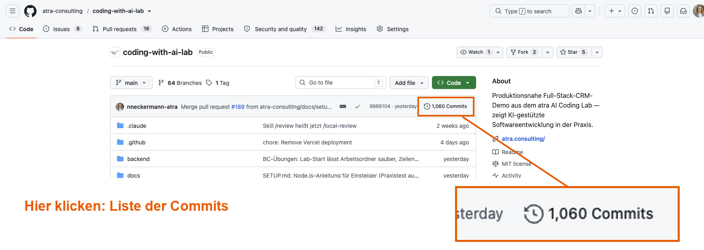

# 11 — Branch und Commit mit dem Agenten, nachsehen im Terminal

**Dauer:** 30 min
**Sozialform:** Paare
**Werkzeug:** Claude Code oder GitHub Copilot CLI, Terminal, Browser
**Voraussetzung:** Aufgabe 10 erledigt: Lab läuft, euer Agent (`claude` oder `copilot`) hat im Projektordner geantwortet
**Ziel:** Der Agent legt euren Branch an, schreibt euer PRD als Commit fest und meldet, was er getan hat — ihr prüft seine Meldung in einem eigenen Terminalfenster nach: zwei eigene Commits auf eurem Branch, das PRD unter `docs/prds/`, der geänderte Satz im Vergleich (`git diff`).

So arbeiten Business Consultants mit Git: Die Befehle tippt der Agent, ihr
gebt den Auftrag und prüft das Ergebnis — wie in Aufgabe 10: Der Agent sagt,
was er getan hat, ihr seht im Terminal nach, ob es stimmt. Dafür müsst ihr
wissen, wo ihr nachseht — welcher Branch, welcher Commit, welche Datei,
welcher Satz.

**Warum das PRD ins Projekt kommt:** In Aufgabe 22 setzt der Agent euer PRD
um. Er liest es nicht aus eurer Notizdatei, sondern aus dem Projekt — wie in
einem echten Team liegt die Anforderung dort, wo der Code liegt. Der Commit
hält fest, welche Fassung gilt: Fragt später jemand „Was war eigentlich
bestellt?“, steht es im Projekt, mit Datum und Namen.

**Warum auf einem eigenen Branch:** Der Branch ist euer eigener Arbeitsstand
neben dem gemeinsamen, freigegebenen Stand `main` — wie ein Entwurf, an dem
ihr arbeitet, ohne das freigegebene Dokument anzufassen. So kommt sich
niemand in die Quere, und am Ende von Aufgabe 22 liegen auf eurem Branch
beide Teile zusammen: euer PRD und der Code, den der Agent dafür schreibt.

Arbeitet zu zweit, aber jede Person an ihrem eigenen Rechner — Branch und PRD
braucht ihr beide für Aufgabe 22. Erst macht Person A die Schritte 1 bis 4,
Person B liest die Befehle mit und sagt, was sie beim Nachprüfen erwartet.
Dann macht B dieselben Schritte an ihrem Rechner, und A liest mit.

## Schritte

1. **Dem Agenten den Auftrag geben.** Startet im zweiten Terminal im
   Projektordner `claude` oder `copilot` und gebt den Prompt unten ein — mit eurem Namen und eurem PRD.
   **Euer PRD** steht in eurer Notizdatei vom Vormittag (Aufgabe 03): den
   ganzen Text kopieren und an der markierten Stelle im Prompt einfügen.
   **Kein PRD zur Hand?** Dann nehmt den zweiten Prompt „Ohne eigenes PRD“ —
   das Muster-PRD liegt schon im Projekt, ihr müsst nichts einfügen. Zum
   Lesen gibt es das Muster-PRD auch als Download `PRD-FIRMA-FAVORIT.md` im
   Trainingsportal unter dieser Aufgabe.
   Lest mit, welche Befehle der Agent ausführt: Ihr kennt sie von der Folie.
   Copilot fragt vor jedem neuen Befehl nach — lest ihn, bevor ihr
   zustimmt.
2. **Ein Fenster zum Nachprüfen öffnen.** Öffnet ein weiteres
   Terminalfenster — macOS: `Cmd+N`; Windows: Git Bash noch einmal öffnen.
   Es zeigt Git-Ausgaben in Farbe und ist besser lesbar als das
   Agentenfenster.

   **Zuerst `cd coding-with-ai-lab`.** Jedes neue Fenster beginnt im
   Benutzerordner. Vergesst ihr das, meldet Git `not a git repository`.
3. **Nachprüfen.** Der Agent hat am Ende drei Angaben gemacht: Branch,
   Ablageort, Commit-Nachricht. Prüft jede im neuen Fenster und notiert:
   stimmt · stimmt nicht.
   - `git status` — die erste Zeile `On branch …` nennt euren Branch.
   - `open docs/prds` (Windows: `explorer "docs\prds"`) — der Ordner öffnet
     sich im Finder bzw. Explorer: Liegt `PRD-FIRMA-FAVORIT.md` darin?
   - `git log --oneline -3` — die letzten drei Commits, der neueste oben:
     Steht euer Commit mit der gemeldeten Nachricht ganz oben?
4. **Eine Änderung vor dem Commit ansehen.** Den neuen Satz gebt ihr selbst
   vor — was im PRD steht, entscheidet ihr, nicht die KI. Mit dem Muster-PRD
   entscheidet ihr die offene Frage zu A6. Sagt dem Agenten:
   „Ergänze im PRD bei A6 den Satz: ‚Nach dem Neuladen der Seite ist die
   Checkbox wieder aus.‘ Lösche dafür die offene Frage. Committe noch nicht.“
   Mit eigenem PRD: Entscheidet eine offene Frage daraus und gebt den Satz
   genauso vor.

   Im Nachprüf-Fenster zeigt `git diff` die Änderung: rot mit `-` der alte
   Stand, grün mit `+` der neue. Steht unten `:` oder `(END)`, kommt ihr mit
   `q` wieder heraus. Passt die Änderung, sagt dem Agenten: „Committe das
   mit der Nachricht ‚docs: PRD präzisiert‘.“ Danach zeigt
   `git log --oneline -3` zwei eigene Commits oben.

   **Ohne zweites Fenster (für Neugierige):** Dieselben Befehle gehen auch
   direkt im Agentenfenster mit `!` davor, zum Beispiel `! git diff` — ohne
   `cd`, aber ohne Farben. Das klappt in Claude Code und in Copilot CLI.
5. **Auf GitHub vergleichen.** Die Trainer haben euch die Commit-Liste auf
   GitHub gezeigt. Öffnet <https://github.com/atra-consulting/coding-with-ai-lab>
   und dort den Link rechts über der Dateiliste: Uhr-Symbol und „… Commits“.

   

   Sucht eure beiden Commits. **Ihr findet sie nicht — und genau das ist das
   Ergebnis:** Eure Commits liegen nur auf eurem Laptop. Ins gemeinsame
   Projekt auf GitHub kommen sie erst, wenn sie hochgeladen (Push) und per
   Pull Request freigegeben werden.

## Folienschritte

1. Agent: Branch anlegen, PRD ablegen, committen — mitlesen.
2. Neues Terminalfenster — zuerst `cd coding-with-ai-lab`.
3. Nachprüfen: `git status`, `open docs/prds`, `git log --oneline -3`.
4. Satz selbst vorgeben, mit `git diff` ansehen, dann committen lassen.
5. Auf GitHub: Warum fehlt euer Commit?

## Prompt

```
Ich möchte mein PRD in diesem Repository ablegen.

1. Lege den Branch training-1126/<vorname-nachname> an.
2. Speichere den Text unten als docs/prds/PRD-FIRMA-FAVORIT.md.
3. Committe die Datei mit der Nachricht "docs: PRD Firmen als Favorit markieren".

Sag mir vor jedem Schritt, welchen Git-Befehl du ausführst und warum.
Pushe nicht. Melde mir am Ende in drei Zeilen: auf welchem Branch ich bin,
wo die Datei liegt und wie der Commit heißt.

<hier euer PRD aus Aufgabe 03 einfügen>
```

Ohne eigenes PRD:

```
Lege den Branch training-1126/<vorname-nachname> an, kopiere
tasks/business-consultants/material/PRD-FIRMA-FAVORIT.md nach docs/prds/
und committe die Datei mit der Nachricht "docs: PRD Firmen als Favorit markieren".
Sag mir vor jedem Schritt, welchen Git-Befehl du ausführst und warum.
Pushe nicht. Melde mir am Ende in drei Zeilen: auf welchem Branch ich bin,
wo die Datei liegt und wie der Commit heißt.
```

## Abnahme

- [ ] `git status` zeigt euren Branch, und `git log --oneline -3` zeigt
      zwei eigene Commits darauf.
- [ ] Ihr könnt zeigen, wo das PRD liegt und welchen Satz ihr im zweiten
      Commit geändert habt.
- [ ] Ihr habt die drei Angaben des Agenten im Terminal nachgeprüft und
      könnt sagen, ob sie stimmen.
- [ ] Ihr könnt sagen, warum euer Commit auf GitHub fehlt.
- [ ] Ihr erkennt die Befehle wieder, die der Agent benutzt hat:
      `git switch -c`, `git add`, `git commit`, `git status`, `git log`.

## Troubleshooting

| Problem | Lösung |
|---|---|
| Der Agent meldet `Please tell me who you are` | Git kennt euch auf diesem Rechner noch nicht. Sagt dem Agenten: „Trag für Git meinen Namen ‹Name› und meine E-Mail ‹Adresse› ein und wiederhole den Commit.“ Das Lab bleibt lokal; jede Adresse genügt. |
| `fatal: not a git repository` | Das Fenster steht im Benutzerordner. `cd coding-with-ai-lab`, dann den Befehl wiederholen. |
| Unten steht `:` oder `(END)`, das Fenster nimmt keine Befehle an | Git zeigt eine lange Ausgabe seitenweise. `q` drücken. |
| `git diff` zeigt nichts | Der Agent hat schon committet. `git show` zeigt den letzten Commit mit rot und grün. |
| `git status` zeigt `On branch main` | Der Agent hat keinen eigenen Branch angelegt. Handheben — die Trainer helfen, den Commit auf euren Branch zu bringen. |
| Der Agent will pushen oder einen Pull Request anlegen | Ablehnen. Im Lab-Repo fehlen euch die Rechte, und euer Branch bleibt lokal. |
| Der Agent macht mehr als bestellt | Stoppen mit `Esc` und sagen: „Nur die drei Schritte, sonst nichts.“ |

## Diskussion

- Welchen Befehl des Agenten hättet ihr ohne die Folie nicht verstanden?
- Woran hättet ihr gemerkt, wenn der Agent die Datei an die falsche Stelle
  gelegt oder auf `main` committet hätte?
- Was müsste passieren, damit euer Commit auf GitHub erscheint — und wer gibt
  ihn dort frei?
